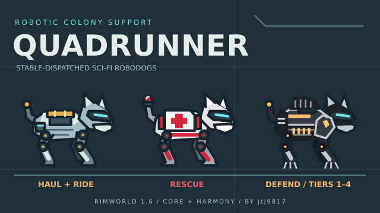

# Quadrunner

Robot dogs for RimWorld: **Quadrunners** haul, clean, supply construction and carry riders; **Medirunners** rescue the downed; **Combatdogs** defend the colony across four upgrade tiers.

**Author:** [jtj9817](https://github.com/jtj9817) · **Game:** RimWorld 1.6 · **Requirements:** Core + [Harmony](https://steamcommunity.com/sharedfiles/filedetails/?id=2009463077)



Complete for personal use, including the post-T9 lore, liveries, walking, rescue and combat animations, and weapon demonstrations. The source is publicly viewable, but this remains a personal mod, not a community project or Workshop release. Issues, pull requests, discussions, projects and the wiki are disabled; no contributions or public support are solicited.

No DLC is required. DLC-enabled configurations and arbitrary mod combinations have not been verified. The saved-game package ID remains `josh9817.quadrunner`; the author name does not change that identity.

Verification history, including packaged scenario runs and an independent save-removal check without the mod assembly, is recorded in [docs/test-runs.md](docs/test-runs.md). Historical results apply to the builds named there, not every later build.

## Hearthline Robotics

*“A good dog for a bad world.”*

Hearthline supplies remote settlements with locally serviceable utility, rescue and security robodogs. Its armed range is marketed as “settlement assurance.”

The **stable's information card** introduces the company. All six dog models, both field consumables and all four built-in weapons have distinct flavor text followed by practical instructions; assembly, rebuild and upgrade bills have accompanying descriptions too.

In **Overview**, hover the robodog-count heading for the stable's lore, a dog's **name or type** for its model description, or the **battery and repair-kit icons** for field-item information. Hover fitted weapons and individual choices in the weapon picker for their descriptions. Upgrade hovers still show the action and material cost.

## Install and play

1. Put the packaged `Quadrunner` folder from `dist/Quadrunner` in RimWorld's `Mods/` directory. Enable **Harmony**, **Core**, then **Quadrunner**, and restart the game. A source checkout or GitHub source ZIP is not a ready-to-play package: compiled assemblies and `dist/` are deliberately excluded from Git.
2. Research **Microelectronics**, then build a **Quadrunner stable** from **Misc** and connect its 200 W power supply. Its 15 slots include dogs currently working away from home.
3. Add **Assemble Quadrunner**, **Assemble Medirunner** or **Assemble Combatdog** bills at the stable. Colonists do the work under Crafting. The **Overview** tab shows each dog's battery, health and current activity.

- **Quadrunners** survey revealed areas when idle and report work within 15 cells to a shared map-wide network. They prioritize Home-area rooms, storage, growing/other zones and unzoned Home before the exterior, retaining an area's coverage across travel legs and revisiting it in later shared sweeps. Only real local scans count as coverage. Discovered hauling, cleaning, construction deliveries and dog retrieval go to the nearest available capable dog by reachable travel cost; there is no stable-centered pickup boundary. Cleaning still requires Home, and normal storage filters and forbidden items are respected. Select an undrafted colonist, right-click a stable or an available Quadrunner, choose **Ride … to…**, and pick a destination. Riders dismount on arrival, drafting or entering a building.
- **Medirunners** rescue reachable downed colonists, guests, prisoners and colony animals to appropriate beds. They do not tend patients or do worker jobs.
- **Combatdogs** answer attack pings and raids. Set a route with the stable's **Add patrol waypoints** / **Clear patrol** buttons, or draft a dog for direct orders. Order paid tier upgrades and choose free built-in gun options in **Overview**. Tier 3 switches between its rifle/LMG and short-range flamethrower; Tier 4 adds the minigun option. Built-in guns are never dropped as loot.
- All robodog models have approximately **3,500 cells** of normal travel per full charge. They seek charging at **10%** (about **350 cells** left) and power down at **0%**; a working Quadrunner's raid drain remains doubled. The powered stable charges and repairs docked dogs. Outdoor dogs can also use safe roofed indoor conduit rooms on a network with stored battery energy; nearby wind turbines invalidate spots (distance configurable in mod settings).
- Other Quadrunners retrieve powered-down dogs. Colonists can **Carry to stable** or automatically deliver field batteries and repair kits made at the stable. Keep a destroyed dog's wreck for its **Rebuild** bill.
- **Coordination and queues:** a surviving stable coordinates every robodog on its map. Without a stable, the newest-built active dog takes over; the queues transfer automatically when that node is lost. Normal work is suspended immediately on detection of a hostile threat, while Combatdogs deploy and Medirunners keep rescuing. Workers stand by until the threat clears, then resume revalidated work. Losing every stable and active dog clears both queues. Coordinator, queue counts and assignment progress appear in the stable/dog inspection text.

## Removing Quadrunner safely

**Do not simply disable the mod on a save that contains its dogs or buildings.**

1. With the colony loaded and Quadrunner still enabled, open **Options → Mod settings → Quadrunner**.
2. Choose **Prepare save for removing Quadrunner...** and read the destructive confirmation.
3. The action first writes `QR_before_removal_<timestamp>`. It releases riders, carried patients and vanilla cargo, removes Quadrunner content and related in-flight shots on all maps and in the world, and creates `QR_removed_<timestamp>`. Mod content is not refunded; surviving injuries are not healed. Surviving battle records keep their IDs, with removed weapon/cover metadata cleared.
4. Note the cleaned save's exact name. **Quit without saving again**, disable Quadrunner, restart and load that cleaned save. The changed-mod-list warning is expected.
5. Keep the backup. To undo removal, re-enable Quadrunner and load the `QR_before_removal_…` backup.

If preparation reports failure, **keep Quadrunner enabled and reload the backup**. No successful clean export is claimed. Bring any off-map robodog cargo without a surviving caravan carrier onto a map before retrying.

## Development

The repository is [jtj9817/Quadrunner-mod-rw](https://github.com/jtj9817/Quadrunner-mod-rw). Source, original artwork and exported textures are tracked; compiled assemblies, packages, decompiled game code, logs and private test profiles are not. No open-source license is granted.

For a local build, install the .NET SDK and Python 3, with RimWorld 1.6 and Harmony available at the paths configured by `tools/env.sh`. `tools/build.sh` lints, builds and installs the assembly into `1.6/Assemblies`; `tools/package.sh` requires a clean committed tree and produces the installable `dist/Quadrunner` folder. Its `BUILD` file identifies the packaged build. The private-game test tools additionally require Steam, Xvfb, xdotool and ImageMagick; texture export requires Inkscape.

Original SVG sources live in `Art/`; `tools/export-textures.sh` exports the committed PNGs. Preview sources before integration and inspect actual private-game screenshots afterwards.

```sh
tools/autotest.py run "Artwork showcase,Prepare removal"  # private visual captures and removal export
tools/autotest.py stop
tools/autotest.py removal-check          # independent observer, no Quadrunner assembly
tools/package.sh                        # requires a clean committed tree; writes dist/Quadrunner
tools/autotest.py --timeout 3600 pkg-run  # cold-launch the package, run every scenario, restore dev link
tools/autotest.py stop
```

In Dev mode, **Debug actions → Quadrunner → Scenario: Run all** runs sequentially on the current map: each scenario spawns its fixtures, makes its calls and cleans up its tracked objects, without automatically saving/reloading the colony. **Scenario...** uses the same live mode for individual scenarios. Live Run all excludes the dedicated **Save and reload** and **Survey: legacy save arrivals** persistence cases and the isolated **Survey bench** cases; select those explicitly on a disposable development map. `tools/autotest.py run` includes every persistence check and benchmark. These fixtures change colony state; **Prepare removal** deliberately saves and removes mod content.

The isolated survey benchmarks intentionally save and reload the same temporary fixture before each historical/current walking phase, then delete that private snapshot. Reports distinguish elapsed planner timing from all-thread process CPU; physical-phase CPU also includes ordinary simulation, rendering and native path jobs. Allocation reports identify the validated counter's scope. Do not run these fixtures on a colony you intend to keep.

`removal-check` requires an export from the **Prepare removal** scenario (`tools/autotest.py run "Prepare removal"`), not an arbitrary player save. The observer loads the export, ticks 600, saves/reloads and ticks another 600 while checking expected vanilla contents and absence of the Quadrunner assembly. The harness rejects any new errors. Tests use only `.devlog/` data and a private Xvfb display, never the player's profile or window.

Automated quicktest starts use flat, low-swampiness, inland temperate forest without rivers, retaining a random world seed. Scenarios build their own rooms and obstacles; this supplies a consistent building-space prerequisite, not a claim of coverage for every biome. Ordinary games are unaffected.

For native hover checks, cold-start the private display with `QR_SCREEN=1280x900` after `tools/autotest.py stop`. Changing the game window's resolution alone does not enlarge Xvfb's pointer bounds. Artwork captures are evidence only after the actual cards/tooltips have been visually inspected.

- Design snapshot: [docs/design.md](docs/design.md)
- Plan and decisions: [docs/plans/0001-quadrunner.md](docs/plans/0001-quadrunner.md)
- Hearthline lore and tooltip plan: [docs/plans/0002-hearthline-lore.md](docs/plans/0002-hearthline-lore.md)
- Shared queue, exploration and failover plan: [docs/plans/0003-network-dispatch.md](docs/plans/0003-network-dispatch.md)
- Area-aware survey implementation: [docs/plans/0004-area-aware-survey.md](docs/plans/0004-area-aware-survey.md)
- Automated work loop and tool reference: [AGENTS.md](AGENTS.md)
- Verification evidence: [docs/test-runs.md](docs/test-runs.md)
