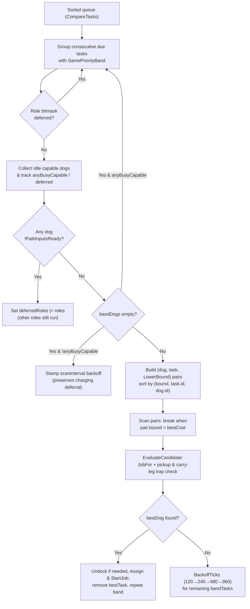

# Queue tracking, order assignment, and runtime algorithms

[Home](../Home.md) › [Architecture](../architecture.md) › Queue tracking, order assignment, and runtime algorithms

> Why Quadrunner's dispatcher, combat/smoke coordinators, survey geometry, and charge-spot caches work the way they do after QR-0004, how each algorithm executes, and which load-bearing invariants future changes must preserve.

| | |
| --- | --- |
| **Source** | `Source/Quadrunner/Network.cs`, `Work.cs`, `Hose.cs`, `Rescue.cs`, `PackCombat.cs`, `Combat.cs`, `SmokeCap.cs`, `Traps.cs`, `Survey.cs`, `Survey.Geometry.cs`, `ChargeSpots.cs`, `Charging.cs`, `Building_Stable.cs`, `Docking.cs`, `Retrieval.cs`, `Tiers.cs`, `TearGas.cs`, `Riding.cs`, `ITab_StableOverview.cs` |
| **Last verified** | 2026-11-20 against `7cfb57e` |
| **Package** | `dist/Quadrunner` build `7ddd4a3.20261120T072951Z` |
| **Tickets** | [QR-0004](../tickets/QR-0004-queue-and-order-tracking-improvements.md) (Closed), [QR-0001](../tickets/QR-0001-area-aware-survey-routing.md) (Done), [QR-0003](../tickets/QR-0003-paired-gun-duplicate-primary.md) (Open) |

## Architectural boundary: why transient indexes sit beside saved lists

Quadrunner deliberately saves **no `MapComponent` or `GameComponent`** so a colony can remove the mod cleanly ([architecture.md](../architecture.md#saved-state-and-clean-removal)). Persistent queue state (`NetworkState.normal`, `NetworkState.war`, `nextId`, `warActive`) lives on exactly one elected physical `Building_Stable` or active `CompRobodog` (`Network.cs:65-83`, `Network.cs:249-280`).

Because `NetworkState` is serialized as two `List<NetworkTask>` collections of ThingID strings—and tests can mutate those lists directly—all fast lookup structures are **transient, per-map fields on `DogNetwork`** rebuilt from the saved lists after load or coordinator failover. No new saved fields were added in QR-0004.

## 1. Queue indexing and O(1) discovery intake

### Why it changed
Before QR-0004 (`6ddb660`), every local scan (`DogWork.ReportLocal`, ~709 cells per active dog every 120 ticks) checked `map.listerHaulables.ThingsPotentiallyNeedingHauling().Contains(thing)` against a `List<Thing>` (`O(H)` per item) and then scanned `State.normal` or `State.war` linearly inside `DogNetwork.Report` (`O(Q)` per item). `Queued`, `Release`, `ReportCasualty`, `FindPawn`, and `DogWork.TrimQueue` also called `.ThingID` inside loops (formatting a new string per iteration), `Finished` scanned `SpawnedDownedPawns` via LINQ for every `Rescue` task, and post-load `NetworkTask.Target(Map)` scanned `AllThings` once per queued task (`O(Q × AllThings)`).

### How it works now
- **Three transient indexes on `DogNetwork`** (`Network.cs:106-111`, `Network.cs:331-365`):
  - `taskIndex`: `Dictionary<(NetworkTaskKind, string), NetworkTask>` for exact `O(1)` deduplication in `Report` (`Network.cs:419-436`).
  - `normalByTarget` / `warByTarget`: `Dictionary<string, NetworkTask>` for `O(1)` membership in `Queued`, `Release`, and `DogWork.TrimQueue` (`Network.cs:412-462`, `Work.cs:236-254`).
- **Count-sync safety guard (`EnsureTaskIndexes`, `Network.cs:331-337`)**: tracks `indexedNormalCount` and `indexedWarCount`. Normal operations keep counts in sync with zero allocations on duplicate hits (`Network: duplicate report allocations` stays flat at `24,576 B` at both queue size 1 and 256). If anything mutates `State.normal` or `State.war` out-of-band, a count mismatch—or the next `RebuildAssignments()`—rebuilds all three indexes automatically.
- **Single-pass post-load target resolution (`ResolveMissingTargets`, `Network.cs:367-410`)**: on load/failover, collects all null-target `targetId`s into a `HashSet<string>`, scans `Map.listerThings.AllThings` (and `Map.mapPawns.AllPawns` only if any IDs remain) **once**, and populates cached `Thing` references in `O(AllThings + Q)`.
- **Per-scan `HashSet<Thing>` for haulables (`Network.cs:578-591`, `Work.cs:86-103`)**: `DogNetwork.Tick` checks if RimWorld's `ThingsPotentiallyNeedingHauling()` is already a `HashSet<Thing>`; if not, it copies into a reusable `haulableSet` once per scan tick and passes it into `DogWork.ReportLocal`. The 2-argument `ReportLocal(observer, network)` overload remains for direct fixture calls.
- **Direct patient predicate (`Rescue.IsPatient`, `Rescue.cs:32-38`, `Network.cs:760`)**: `Finished()` tests `Rescue.IsPatient(patient)` in `O(1)` instead of `Rescue.Patients(Map).Contains(patient)`.

## 2. Order assignment: equal-priority bands, Chebyshev pruning, and backoff

### Why it changed
The original `AssignAll` had three distinct flaws:
1. **Busy-dog backoff stall (`Q1`)**: when all capable dogs were busy on assigned tasks, the dog loop tested zero dogs, left `nearest == null`, and stamped `task.retryAt = Now + 120` on **every remaining task in the queue**. A worker or Medirunner finishing a job 10 ticks later ignored the waiting backlog and went off to survey or dock until the backoff expired.
2. **Task-ID FIFO beating distance + unpruned A\* (`Q2`)**: evaluating one task at a time in `task.id` order let dogs walk past nearby targets to claim older distant ones, caused pairs of dogs to crisscross, and ran `JobFor` + full A\* `FindPathNow` for *every* idle dog on *every* task with no lower-bound cutoff.
3. **Whole-scheduler abort on a single area change (`Q7`)**: one dog failing `PathInputsReady(dog)` returned `false` from `AssignAll`, halting war tasks, `DispatchFires()`, and normal tasks for unrelated roles.

### How `AssignAll` executes now (`Network.cs:1262-1402`)

Key design logic:
- **Priority tiers remain strict (`SamePriorityBand`, `Network.cs:1156-1169`)**: tasks are only grouped into the same matching band when they have the exact same `Rank` (`Recover -3 > Blood/Foam Hose -2 > Animal Hose -1 > Retrieve 0 > Frame 1 > Blueprint 2 > Haul 3 > Clean 4`), the same `(Rescue.Rank, BleedRateTotal)` for `Rescue`, or the same `CombatOrder` for `Combat`. Lower-priority work can never outrank higher-priority work by being closer.
- **Admissible Chebyshev lower bound (`LowerBound`, `Network.cs:1171-1184`)**:
  - Uses `min(round(TicksPerMoveCardinal), round(TicksPerMoveDiagonal)) * max(0, chebyshev - slack)`—the same RimWorld 1.6 nonnegative path-cost guarantee proven in `Survey.Select` (`Survey.cs:166-169`).
  - `slack` is `0` for `PathEndMode.OnCell`, `1` for `Touch`/`ClosestTouch` (stopping adjacent to the target), and `2` for docked dogs (accounting for `ThingPlaceMode.Near` drop offset around `InteractionCell`).
  - `Frame` and `Blueprint` tasks return `0f` because `TryBuildAndRoute` paths to the *material stack* (`candidate.targetA`), not to the frame itself.
  - Because `bound <= actual route`, stopping at strict `pair.bound > bestCost` never prunes a genuinely cheaper route (such as a wall-free longer beeline in `Network: nearest dog wins`) and preserves deterministic `(task.id, dog.thingIDNumber)` tie-breaks.
- **Busy vs. unavailable backoff (`Network.cs:1319-1324`)**:
  - If `bandDogs.Count == 0` and **`anyBusyCapable == true`**, no `retryAt` is stamped—the backlog stays immediately ready for the next dog that finishes.
  - If `bandDogs.Count == 0` and **`anyBusyCapable == false`** (e.g., all Medirunners are charging with `WantsCharge == true`), `task.retryAt = Now + scanInterval` *is* stamped. **Why this distinction is load-bearing:** `Manual rescue dispatch` (`Scenarios.Rescue.cs:99-118`) explicitly asserts that rescues queued while all medics are charging enter retry backoff until the automatic retry window or a manual **Dispatch Rescuedogs** click.
  - If idle dogs *were* tested and none succeeded (`bestDog == null`), `BackoffTicks` (`Network.cs:1144-1149`) applies capped exponential backoff (`120 → 240 → 480 → 960` ticks) so unhaulable full-stockpile items stop saturating dispatch ticks. `Assign()` and manual `TryDispatch(force: true)` reset `failCount = 0`.
- **Role-scoped `PathInputsReady` deferral (`Network.cs:649-658`, `1151-1154`)**: bitmask flags `RoleWorker | RoleMedic | RoleCombat` defer only tasks whose role includes an ungathered allowed area, letting unrelated roles (including `DispatchFires` when `RoleMedic` is not deferred) run normally.

## 3. Job-boundary handoff and stationary progress monitoring

### Selection-only handoff in `TakeOrder` (`Network.cs:1404-1474`, `1546-1547`)
- **Why:** Previously, only `Fire` (`TakeFireOrder`) and pack combat (`PackCombat.Target`) handed a dog its next task immediately when a job ended. Workers finishing a haul/clean and Medirunners finishing a rescue fell into `IdleJob`, starting `QR_Survey` (with full A\* selection) or `QR_Dock` for up to 59 ticks before the next `DogNetwork.Tick()`.
- **How:** `TakeNextOrder(dog)` runs inside `TakeOrder` after `TakeFireOrder` and repair/availability guards, scanning `State.war` then `State.normal` (if `!War`) using the same `SamePriorityBand` + `LowerBound` + `TryBuildAndRoute` logic for that single dog.
- **Important constraint:** `TakeOrder` executes inside RimWorld's `ThinkNode_JobGiver.TryGiveJob`. `TakeNextOrder` is strictly **selection-only**—it calls `Assign` and returns the `Job` for the requesting `dog`, and never calls `StartJob` or `EndCurrentJob` on any other pawn.

### Stationary progress tracking (`Network.cs:864-896`, `1520-1525`, `Hose.cs:266,358`)
- **Why:** `AttackStatic`, `AttackMelee`, `Firefighting`, and `JobDriver_CleanWithHose` all use `ToilCompleteMode.Never`. While standing on one tile shooting a tough target (e.g., a Centipede) or spraying a large patch for more than `progressTimeout` (2,500 ticks), `Position`, `CurToilIndex`, and `ticksLeftThisToil` never changed, and `TakeOrder`'s `IsContinuation` branch returned early without bumping `progressAt`—causing `Reconcile` to cancel active fights mid-engagement.
- **How:** `ActivityTick(dog)` returns `busy.startedTick` when `dog.stances?.curStance is Stance_Busy busy`, or `hose.SprayProgressTick` (updated in `JobDriver_CleanWithHose.Spray` whenever work is applied). `Reconcile` treats a change in `ActivityTick` as progress, and `TakeOrder` refreshes `progressAt` on `IsContinuation` when in a busy stance. Genuinely stuck pawns (blocked `Goto` or idle `Wait`) still return `-1` and time out at 2,500 ticks.

### Multi-target hose reservation skipping (`Hose.cs:82-135`, `Network.cs:1254-1256`)
- **Why:** A 50-tile blood patch creates 50 `NetworkTask`s, but a single `QR_CleanWithHose` job assigns only Task #1 while reserving all 50 `Filth` things. Tasks #2–#50 stayed `assigneeId == null`, so `Hose.PriorityTasks` kept ranking them `-2` (ahead of hauling/construction) and re-running BFS every 60 ticks.
- **How:** Both `Hose.PriorityTasks` and `TargetPotentiallyAssignable` (for `Haul` and `Clean` only—**never** `Frame`/`Blueprint`, which multiple haulers can supply concurrently) skip targets where `Map.reservationManager.IsReserved(target)` is true. `Hose.PriorityTasks` reuses static scratch collections and records sub-threshold patches (`< hoseMinTiles`) in `primaryChecked`/`animalChecked` so 2–3 tile patches are BFS'd once instead of once per tile.

## 4. Combat, packs, smoke clusters, and trap avoidance

- **Per-cluster `SmokeCoordinator` snapshots (`SmokeCap.cs:20-139`, `Network.cs:192`)**:
  - **Why:** `winners` was previously keyed by `(map.uniqueID, window)`, so two T4 squads fighting >15 cells apart collided on one 3-dog snapshot and the second squad fired zero smoke for 900 ticks.
  - **How:** `ClusterOf` builds the connected component of same-faction, non-downed, non-charging smoke-equipped robodogs within `packRange` via BFS. Each `(map.uniqueID, window)` stores a `List<ClusterSnapshot>` (`members`, `winners`). Lookups match by `members.Contains(dogId)` or set overlap (so mid-window deaths/drift never create a second snapshot that exceeds 3 pops in a window), while disjoint squads each get an independent 3-winner snapshot. `SmokeCoordinator.ClearAll()` runs inside `DogNetwork.ClearAll()`.
  - **Note:** `ClusterOf` deliberately does *not* require `CurJobDef == AttackStatic`, because `Tier 4 tear gas and smoke cluster` (`Scenarios.TearGas.cs:291-293`) queries `SmokeCoordinator.CanPop(dog)` directly across all 4 dogs after reload.
- **Pack capture feasibility & unengaged hostile preference (`PackCombat.cs:52,199-215`, `Combat.cs:145-167`, `Network.cs:695-700`)**:
  - `PackCombat.CaptureKeeper` now requires `Combat.CanPotentiallyCapture(dog, downed)` so non-leading T1/T2 dogs are not pulled out of combat when no free prisoner bed, prison room, empty room, or trap-free path exists.
  - `PackCombat` records `targetedEnemies` (`IsTargeted(enemy)`). `CombatOrder` ranks `0 = capturable downed`, `1 = unengaged standing`, `2 = pack-focused standing`, `3 = downed insectoid`, so solo Combatdogs outside pack range engage unopposed threats before piling onto a pack's target while still keeping all standing threats ahead of downed insectoids.
  - When `Combat.CaptureJob` releases a downed enemy already inside a prison/empty room (`network.Release(target)`), `AssignAll` detects `!Queued(pair.target)` and removes the task from `bandTasks` immediately instead of probing remaining dogs (`Network.cs:1361-1369`).
- **Carry/drop-off trap checks from the pickup cell (`Traps.cs:51-82`, `Combat.cs:155,180,204`, `Network.cs:1209-1217`)**:
  - `TrapAvoidance.RouteEntersTrapFrom(dog, start, dest, mode, out holdCell)` checks the delivery leg starting at `start` (skipping `start` itself so a dog may always step off a trap). `Combat.CaptureJob` uses `target.Position` rather than `dog.Position`, and `TryBuildAndRoute` checks the carry leg (`destination.Cell → candidate.targetB`) for non-combat carry jobs (`Rescue`, `Retrieve`, `Recover`, `Haul`, `Frame`, `Blueprint`).

## 5. Subsystem caches and per-tick invariants

- **Per-area `Survey.Geometry` invalidation (`Survey.Geometry.cs:23-25,144-217,326`, `Survey.cs:22,258-271`)**:
  - Moving a `PassThroughOnly` rock chunk or tree still fires `ThingChanged`, but `Refresh()` records only the areas whose cell ownership, standability, or doorway adjacency changed in `dirtyAreas`. Untouched rooms, zones, and `Outside` keep their materialized `candidates` intact across geometry revisions.
  - Door-adjacent cells are precomputed once per rebuild from `map.regionGrid.AllRegions` where `region.IsDoorway` instead of calling `GetDoor` on 4 neighbors for every standable exterior cell.
  - `Area.exhausted` caches candidates where `Useful(area, point)` returned `false` (cleared on `BeginSweep`, `Forget`, or area rebuild), avoiding repeated 709-cell radial scans, and `BinarySearch` replaces linear `List.Contains` on sorted `area.candidates`.
- **Event-driven `ChargeSpots` with lazy BFS (`ChargeSpots.cs:33-119,156-243`, `Network.cs:203`)**:
  - Replaced full-map building hashing (`Signature`) with `map.events` subscriptions (`BuildingSpawned`, `BuildingDespawned`, `RegionsRoomsChanged`, `RoofChanged`), unsubscribed via `ChargeSpots.Forget(map)` / `ClearAll()`.
  - `TurbineBuffer(map, distance)` pre-expands wind-turbine cells once per rebuild instead of running a radial search per candidate cell.
  - `Best(dog)` groups spots by `Region` upfront and evaluates `UsableBy(spot, dog)` **lazily inside `RegionTraverser.BreadthFirstTraverse`**, stopping after 5 usable spots.
  - **Preserved Plan 0001 contract:** `ChargeSpots.Build` intentionally keeps `break` when a conduit's single nearest free cell lies within `turbineDistance` of a turbine (`ChargeSpots.cs:123`). `Charging maze` (`Scenarios.Charging.cs:293-309`) verifies that a room whose conduit-adjacent cell is 4 cells from a turbine's wind zone yields no spot at `turbineDistance = 6`.
- **Other load-bearing details:**
  - `JobGiver_WaitInRoom.CellInNearestRoom` (`Docking.cs:97-116`) now verifies a standable, reachable cell *inside* the `BreadthFirstTraverse` callback so BFS continues past blocked regions.
  - `Building_Stable.TickRebuild` (`Building_Stable.cs:536`) throttles unpaid material scans with `this.IsHashIntervalTick(25)`. **Why 25:** `ManualRebuildPending` arbitrates colonist bills on `this.IsHashIntervalTick(250)` (`Building_Stable.cs:562`); `25` divides `250` evenly so every arbitration tick is still evaluated.
  - Docked injury healing (`Building_Stable.cs:497-504`), conduit battery draw (`Charging.cs:111-135`), and `Tiers.Arm` fast-path (`Tiers.cs:78-85`) avoid per-tick LINQ/equipment scans. `Tiers.Arm` runs `EnsureSupplementals` only when changing or equipping a weapon because `TakeNewDog`, `Upgrade`, and `MigrateLoadout` already ensure supplementals on entry/load.
  - `JobDriver_CarryToStable.CheckCarrierBattery` (`Retrieval.cs:286-291`) and `DogWork.JobFor` (`Work.cs:203-208`) return discarded temporary `Job`s to `JobMaker.ReturnToPool`.
  - `Gas_TearGas.HasGasMask` (`TearGas.cs:95-105`) caches `Apparel_GasMask` once; `DamageWorker_TearGas.ExplosionAffectCell` (`TearGas.cs:190-203`) clears static explosion state in `finally`.
  - `Riding.EnteringIndoors` (`Riding.cs:106-129`) peeks the actual post-door node in `rider.pather.curPath` before falling back to `next + (next - rider.Position)` so diagonal door approaches do not inspect adjacent walls.
  - `ITab_StableOverview.FillTab` (`ITab_StableOverview.cs:53-65`) caches `Rows(stable)` per `(stable, TicksGame, Docked.Count)` and invalidates immediately on gun-pick or upgrade button clicks.

## Related

- [Architecture](../architecture.md) — full runtime map, Think Tree ordering, Harmony patches, and clean-removal contract
- [QR-0004](../tickets/QR-0004-queue-and-order-tracking-improvements.md) — findings, commit mapping, and acceptance checklist
- [Plan 0003: Shared dispatch network](../plans/0003-network-dispatch.md) — coordinator election, war mode, and local-discovery specification
- [Test runs](../test-runs.md) — dev and packaged (`7ddd4a3.20261120T072951Z`) verification logs

## Backlinks

<!-- wiki:backlinks:start -->
| Page | Summary |
| --- | --- |
| [Quadrunner wiki](../Home.md) | RimWorld 1.6 mod (Core + Harmony only) adding stable-dispatched utility, rescue, and four-tier combat robot dogs with clean save removal. |
| [Architecture](../architecture.md) | **Superseded design:** `docs/design.md` is a snapshot of the living design doc. Its work-dispatch and queue sections are superseded by [plan 0003](plans/0003-network-dispatch.md); the file says so itself at `docs/design.md:6`, and [plan 0001](plans/0001-quadrunner.md) repeats it at line 6. Read those sections as history, not as the current dispatch specification. |
<!-- wiki:backlinks:end -->
