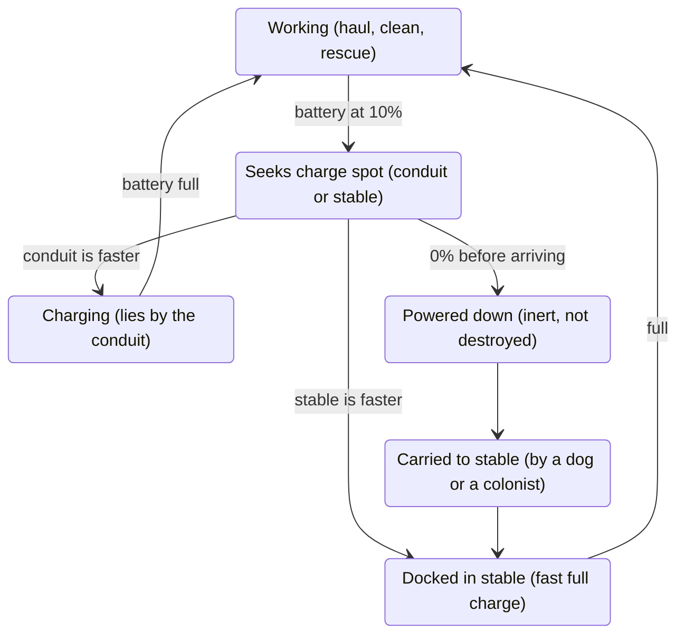
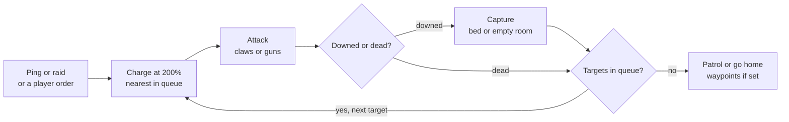

# Quadrunner Robodog Mod: Design Doc

> Snapshot of the living design doc on claude.ai, taken 2026-10-19 (doc rev 39):
> <https://claude.ai/artifact/HaFBXDTNRNVzWa79Hnd9K5>. Author: Josh Toledo. The two diagrams are redrawn here as
> Mermaid. If the online doc changes, refresh this file and note the new rev. Decisions taken during
> development are recorded in [`plans/0001-quadrunner.md`](plans/0001-quadrunner.md), which wins over this snapshot.

## Overview and locked-in decisions

Quadrunner is a RimWorld 1.6 mod that adds stable-dispatched robot dogs that haul, clean, supply construction, carry riders, and (as the Medirunner) rescue downed colonists and (as Combatdogs) defend the colony, with Harmony as its only dependency.

| Area | Decision |
| --- | --- |
| Game version | RimWorld 1.6 only: .NET Framework 4.7.2, Harmony 2.4.3 |
| Dependencies | Harmony only. No DLC, no Giddy-Up, no frameworks |
| Units | Quadrunner (base dog), Medirunner (medic), Combatdog (tiers 1–4) |
| Research | Microelectronics only, for every dog, every Combatdog tier and the stable |
| Dog recipes | Steel, plasteel, advanced components, scaled up per Combatdog tier |
| Low battery | 10% |
| Retrieval | Dogs carry powered-down dogs back to the stable |
| Charging | Lie down on a standable cell in a roofed indoor room with a conduit, found by pathfinding; never near wind turbines |

## Going DLC-free

Without Biotech there is no mech repair, no recharger and no mech work system, so all of that is our own code.

**What the dogs are made of.** The base game already has mechanoids as enemies, so a Mechanoid flesh type exists without any DLC. Reusing it gives no bleeding, no pain and mechanical wound visuals for free. The catch: some game code assumes that flesh type means a hostile mech, so it needs careful testing. The safer route, and the starting choice, is our own flesh type with the same properties.

**Where dogs get built.** A recipe on the fabrication bench would also require Fabrication research, breaking "Microelectronics and nothing else." Instead, the stable is the crafting station: an "Assemble Quadrunner" bill, and the finished dog docks straight into that stable. Advanced components normally need Fabrication to craft, so early on players buy or loot them. That is a progression gate, not a research one.

Proposed starting costs. Batteries and repair kits are bills at the stable; Combatdog upgrades are ordered from its Overview tab:

| Item | Steel | Plasteel | Advanced components | Other |
| --- | --- | --- | --- | --- |
| Quadrunner | 80 | 30 | 1 | — |
| Medirunner | 80 | 50 | 2 | — |
| Combatdog, Tier 1 | 100 | 50 | 2 | — |
| Upgrade to Tier 2 | 100 | 75 | 2 | — |
| Upgrade to Tier 3 | 150 | 100 | 3 | — |
| Upgrade to Tier 4 | 200 | 150 | 4 | — |
| Robodog battery | 20 | — | — | 1 regular component |
| Robodog repair kit | 30 | 10 | — | — |
| Stable (building) | 150 | — | — | 4 regular components |

## The stable

The stable docks up to 15 dogs of any type, sends them out, repairs and fully recharges them quickly, runs every dog bill and receives combat pings.

- **Capacity:** 15 slots shared by Quadrunners, Medirunners and Combatdogs.
- **Dispatch:** every few seconds it checks its service radius for work and releases one dog at a time. Construction delivery has no radius: dogs supply blueprints and frames anywhere on the map.
- **Repair and charging:** docked dogs are repaired and charged to 100% much faster than at a conduit. A low dog goes wherever it will be full soonest, its stable or a conduit, counting travel time.
- **Bills:** assemble Quadrunners, Medirunners and Tier 1 Combatdogs; make robodog batteries and repair kits.
- **Overview tab:** one row per assigned dog showing type, tier, battery, health and current job. For Combatdogs it also sets what fills each weapon slot and orders tier upgrades, which install that tier's gun.
- **Patrol waypoints:** a stable button places waypoints its Combatdogs walk in order while deployed.
- **Ping receiver:** dispatches Combatdogs when any dog is attacked, as described under Combatdogs.

## Conduit charging

A dog charges by lying on a standable cell next to a conduit in a roofed indoor room, picked by searching outward through the map's regions.

A cell is a valid charge spot when all five hold:

- It is standable, so the dog can lie down.
- It is in a roofed room the game does not treat as outdoors.
- The room has a conduit, inside the room or in a wall bordering it. The dog lies on the nearest standable cell to that conduit. Conduits under walls are common, so this rule matters.
- It is not within N cells of a wind turbine or of the area the turbine occupies. N is a mod setting, default about 6.
- The conduit's power network has stored battery energy. Dogs drain batteries directly. A network with generators but no batteries does not count, because a pawn cannot easily act as a power consumer.

**Finding the best room.** RimWorld divides the map into regions, chunks of connected walkable cells, and can search outward through them from a pawn (`RegionTraverser`). The search visits nearer areas first and respects doors and walls. The dog collects the first few qualifying rooms and scores them on:

- Path distance (weighted highest)
- Battery energy left on that network
- Dogs already charging there, so they spread out
- Danger, so fire or enemies rule a room out

The list of valid charge spots per map is cached and rebuilt only when conduits, turbines or rooms change.

**Wind turbines.** "Next to" means physical proximity to the turbine itself or to the area it occupies, including the clear space it needs to run.

## Power-down and retrieval

A dog heads to charge at 10% and powers down at 0%; a powered-down dog is carried to the nearest stable with a free slot and charged to full there.

*battery and retrieval flow · 6 states, 1 loop*

A dog that runs dry on the way to a charger comes home, charges fully at the stable and goes back to work, unless a raider carries it off first.

**Powered down is a condition, not destruction.** The dog lies on the floor like a downed pawn. The stable spots powered-down dogs during its regular scan and dispatches a healthy dog. Colonists can also use a right-click "Carry to stable" option.

**Field fixes.** Instead of hauling a dog home, colonists automatically carry a robodog battery or repair kit to it whenever one is needed and in stock. The battery charges it fully on the spot; the kit repairs its damage. Both are bills at the stable.

**Tuning.** Set battery drain per cell so 10% carries a dog about 150 cells. Running dry mid-trip then stays a rare story event, not a constant chore.

## Riding without other mods

Riding uses a "rider drives, dog carries" model: the colonist keeps their own job and path but moves at the dog's speed, with the dog drawn underneath. Vanilla 1.6 has no mount system, so we build it.

Most of it needs no Harmony. The key tool is a stat part. A stat like move speed is calculated like a recipe: a base value plus optional extra steps that each adjust the result. Our extra step says "if this pawn is riding, use the dog's speed instead." A plain XML patch adds that step to the move-speed stat, so no game code changes.

| Piece | How | Harmony? |
| --- | --- | --- |
| Right-click a Quadrunner, choose "Ride" | 1.6's built-in `FloatMenuOptionProvider` for right-click options | No |
| Rider moves at the dog's speed | Custom stat part added to move speed | No |
| Dog follows the rider | A "being ridden" job that locks the dog to the rider each tick | No |
| Auto-dismount at the destination, indoors, when drafted, or when the rider is downed | A component on the dog that checks these conditions | No |
| Rider drawn sitting on the dog's back | Small patch where pawn draw positions are calculated; per-direction offsets set in XML | Yes |
| Colonists auto-call a dog for long trips (phase 2) | Hook into job start: far destination and a dog nearby means mount first | Yes |

In v1, riders dismount when drafted. Mounted combat comes later.

## Combatdogs

Combatdogs are a four-tier line that deploys on a ping, a raid or a player order, charges hostiles at 200% move speed, patrols the stable's waypoints, and returns home once no targets remain.

*Combatdog behavior loop · 2 decisions*

A downed target is captured and a dead one is skipped; either way the dog takes the next target in its stable's queue, nearest first.

| Tier | Weapons | Durability | Movement |
| --- | --- | --- | --- |
| 1 | Built-in claws, melee only | Base | 200% when deployed |
| 2 | One built-in gun | Much more durable | 200% when deployed |
| 3 | Two weapon slots; one can be a flamethrower | Much more armor | 200% when deployed |
| 4 | Minigun | Extreme armor | 200% when deployed, minus the minigun penalty |

**How it maps to the game:**

- **Tiers are separate models.** Every Combatdog is built at Tier 1. Upgrading from the stable's Overview tab rebuilds the dog as the next tier, keeping its name, and installs that tier's gun.
- **Built-in guns, like turrets.** Weapons are part of the dog and are never dropped or picked up. The stable's Overview tab sets what fills each slot.
- **Holding weapons.** Combatdogs use the same "tool user" intelligence as vanilla mechanoids, which is what lets a pawn wield weapons. Quadrunners stay animal-like so they can be ridden.
- **Claws.** Melee attacks defined on the race (cut and scratch). XML only.
- **Second slot.** Vanilla pawns hold one weapon, so the second slot is a custom mount. This is the riskiest piece of Tier 3.
- **Flamethrower.** Core RimWorld has no flamethrower, so the mod adds one.
- **Minigun.** Core has a minigun, so Tier 4 reuses it.
- **Drafting.** The player can draft Combatdogs and order priority targets.
- **Capture.** Carry the downed enemy to a free prisoner bed. With none free, carry it to the nearest empty room that isn't a colonist bedroom or barracks and leave it there downed, not as a prisoner.

### Pings, target queue and patrols

Any dog attacked by a hostile pings its stable, and the stable sends a Combatdog after that attacker, however far away it is.

- **Ping.** Any Quadrunner, Medirunner or Combatdog hit by a hostile sends a ping naming the attacker.
- **Dispatch.** The stable sends a docked or returning Combatdog. The service radius does not apply.
- **Queue.** Each stable keeps a queue of pinged hostiles. Hostiles a Combatdog sees inside its own area of effect join it. Nearest goes first.
- **Retarget.** While en route, the dog checks every tick whether its target is still standing. If the target is downed or dead, it takes the next queued target or heads home.
- **Redirect.** A Combatdog heading home answers new pings. One retreating on low battery does not.
- **Patrol.** Once deployed, a Combatdog walks the stable's waypoints in order and engages anything inside its area of effect. Patrols run only while deployed.

**Performance.** The per-tick check only reads the target's state. Paths are recalculated only when the target changes, and the queue is re-sorted about once a second.

**Low battery.** At 10% mid-fight, the dog retreats to charge and flashes a yellow siren light so the player sees it leaving.

## Edge-case rules

Every edge case below has a settled behavior except where it points to Open questions.

| System | Scenario | Behavior |
| --- | --- | --- |
| Charging | No valid charge spot anywhere | Return to the stable and charge there |
| Charging | Batteries empty mid-charge | Search again |
| Charging | Room stops qualifying mid-charge | Get up and search again |
| Charging | Prisons, bedrooms, freezers | Never prison cells; bedrooms only when nobody sleeps there; freezers allowed |
| Charging | Allowed areas | Respected like animals; spots outside the area don't count |
| Stable | Stable destroyed | Dogs move to the nearest room that isn't a colonist bedroom or barracks and wait there |
| Stable | Stable loses power | Dispatching continues; repair and charging pause |
| Stable | Overlapping service radii | The stable with the closest idle dog dispatches; each job is claimed once |
| Stable | Stable uninstalled | Dogs come out and wait, then walk to the stable once it is reinstalled anywhere |
| Threats | Raid starts | Quadrunners finish their task at 3x speed with faster battery drain, then dock at their stable |
| Threats | Rescue under fire | Allowed |
| Threats | Rescue order | Colonists, then guests, then prisoners, then colony animals; never enemies |
| Threats | Several downed at once | Fastest-bleeding first, one Medirunner per patient |
| Threats | Raider reaches a dog at 0% | The raider can carry it off; the dog can't resist |
| Combat | Target downed or dead before the Combatdog arrives | Take the next queued target, or head home |
| Combat | New ping while heading home | Redirect to the new target |
| Combat | Combatdog hits 10% mid-fight | Retreat to charge with a yellow siren light; ignore new pings until charged |
| Combat | No free prisoner bed | Carry the downed enemy to the nearest empty room that isn't a colonist bedroom or barracks; it stays there downed, not as a prisoner |
| Riding | Dog hits 0% while ridden | Rider dismounts safely, dog powers down, retrieval starts |
| Map | Caravans | Dogs can't join caravans in v1 |
| Retrieval | Carrier hits 10% while carrying | Finish if the stable is closer than the nearest charge spot; otherwise set the dog down and go charge |
| Retrieval | Powered-down dog in the field | Colonists automatically bring a robodog battery or repair kit instead of hauling it home |
| Retrieval | Powered-down dog in a fire | The retrieving dog puts the fire out, then carries it home |
| Retrieval | Powered-down dog unreachable | Leave it; show an alert with a jump-to button |
| Retrieval | Dog destroyed in combat | Leaves a wreck, rebuilt at the stable for about half the recipe |

All dogs also never spawn wild or in manhunter packs, are immune to animal insanity, psychic drones and disease, have no food or rest needs, never rot, and can't be tamed, trained, slaughtered or hunted. The mod can be removed from a save cleanly.

## Harmony patch list

The whole mod needs about six Harmony patches:

- The rider draw offset
- Auto-mount on long trips (phase 2)
- Possibly a few small fixes where vanilla hauling or cleaning code assumes the worker has human skills or work priorities
- Letting raiders carry off powered-down dogs, since vanilla raiders kidnap downed colonists, not animals
- The second gun mount on Tier 3 Combatdogs, if a custom attack alone can't do it
- Drafting Combatdogs, so the player can give them orders

Everything else (the stable, charging, retrieval, the Medirunner, the Combatdog targeting loop and the stat part) is plain XML plus our own C#. That keeps the mod light and unlikely to conflict with others.

## Testing plan

Testing runs on vanilla RimWorld 1.6 with no DLCs: a manual checklist first, then an automated scenario runner in dev mode.

**Tools** (none ship to players):

- **Dev quicktest** for a fresh small map every launch: the main-menu button in dev mode, or the `-quicktest` launch argument
- **Dev mode** for god mode, spawning, damaging pawns and the debug log
- **Quadrunner debug actions:** set battery %, power down a dog, force a dispatch, spawn a dog docked, highlight valid charge spots, dump the charge-spot cache to the log
- **TweakValues** to tune rider draw offsets live, without recompiling
- **Vanilla region and room overlays** to confirm the charge-spot search sees what we expect

**Phases:**

- Manual: after every build, load each saved test colony, run the scenario, check the log and save and reload mid-action.
- Automated: a dev-only debug action loads each scenario, runs it for a set number of ticks and logs pass or fail.

**Starting scenarios**, one saved test colony each:

- Charging maze: no valid spot, a spot behind a forbidden door, a turbine beside a qualifying wall
- Batteries draining mid-charge
- Stable fire with docked dogs, then the fallback to the nearest non-bedroom room
- Mass-casualty raid: three downed colonists, one Medirunner
- Raider carrying off a dog at 0%
- Riding until the dog hits 0%
- Field battery and repair kit used on a powered-down dog
- Ping chain: attack a Quadrunner far from the stable, kill the attacker before the Combatdog arrives, ping again while it heads home
- Combatdog sweep: mixed raid, captures with and without a free prisoner bed, patrol waypoints
- Low-battery retreat mid-fight with the siren light
- Tier upgrade keeps the dog's name and installs the right gun
- Drafted Combatdog ordered onto a priority target

**Pass criteria:** zero red errors in the log, and every action survives a save and reload partway through.

No DLCs are owned, so the code never touches DLC systems. Before release, one tester who owns the DLCs runs the scenarios.

## Open questions

None right now: every design question so far is settled.

## Sources

- [Modding Tutorials – RimWorld Wiki](https://rimworldwiki.com/wiki/Modding_Tutorials)
- [HarmonyRimWorld – GitHub](https://github.com/pardeike/HarmonyRimWorld)
